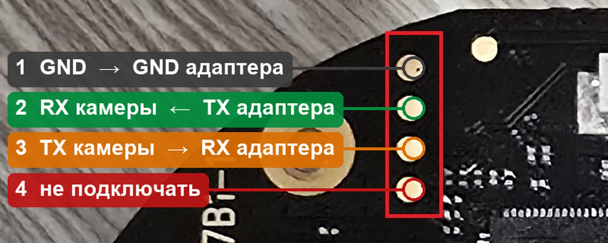
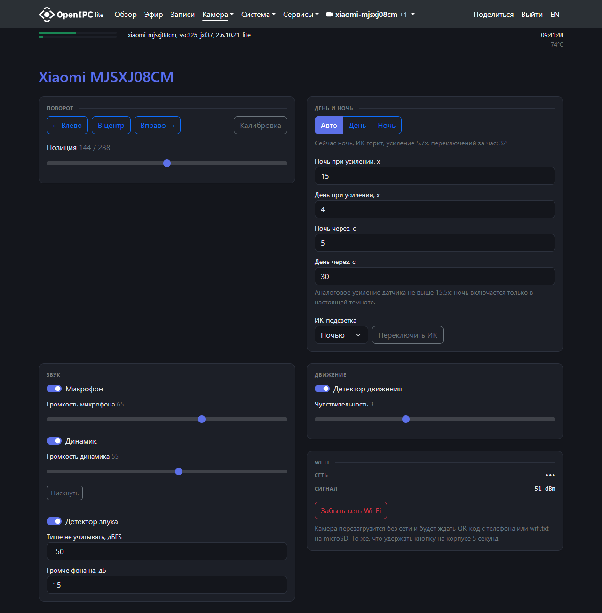
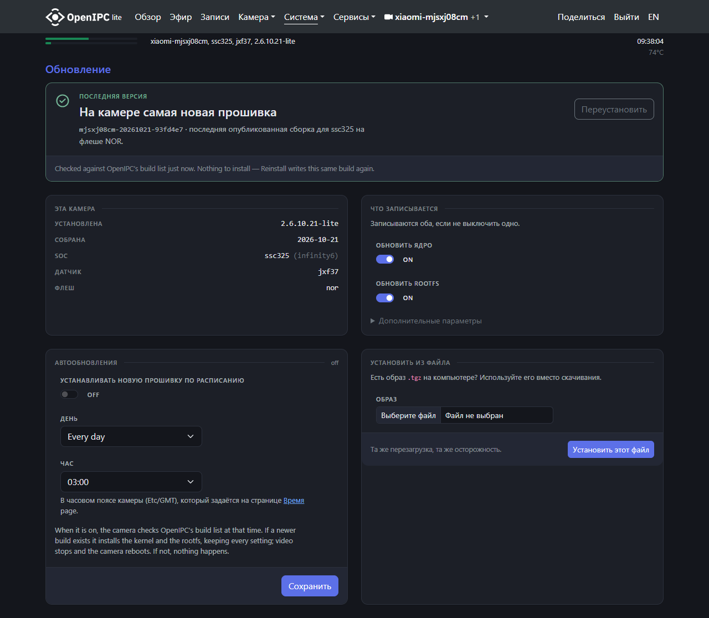

# OpenIPC для Xiaomi MJSXJ08CM — релизы

Сборки [OpenIPC](https://github.com/OpenIPC/firmware) для камеры Xiaomi Mi Home Security Camera 360° 1080p
**MJSXJ08CM** (SigmaStar SSC323, датчик JX-F37, Wi-Fi SSW101B).

Файлы релиза:

| файл | зачем |
|---|---|
| `openipc-mjsxj08cm.tgz` | прошивка: `uImage.ssc325` (ядро) и `rootfs.squashfs.ssc325` (корневая ФС). Обновление ставит только его |
| `uInitrd`, `boot.txt` | только для первой установки: запуск OpenIPC в ОЗУ с microSD (шаг 4) |

Типовая сборка OpenIPC `ssc325` камере не подходит: в ней нет драйвера F37, Wi-Fi SSW101B и `/linuxrc`, камера с ней
не загрузится. Камера с заводской прошивкой `.tgz` через веб-интерфейс не примет — первая установка только через UART.

> Всё проверено на одной камере. **Запись флеша — на свой риск.** Без полной копии флеша (шаг 3) отката нет.

**Порядок первой установки:** UART → вход в U-Boot → копия флеша → OpenIPC в ОЗУ с карты → запись во флеш →
Wi-Fi и пароль. Флеш меняется только на шаге 5.

## Чем сборка отличается от типовой

- Загрузчик Xiaomi (IPL + U-Boot) и его env не меняются. U-Boot грузит ядро с 0x50000 и запускает `init=/linuxrc`,
  в образе `/linuxrc` ведёт на `/init` OpenIPC.
- Разметка флеша заводская, имена разделов задаёт `mtdparts` в ядре:

  | mtd | раздел | смещение | размер | что там |
  |---|---|---|---|---|
  | 0 | boot | 0x000000 | 0x050000 | IPL, U-Boot, env — только чтение |
  | 1 | kernel | 0x050000 | 0x200000 | `uImage.ssc325` |
  | 2 | rootfs | 0x250000 | 0x760000 | `rootfs.squashfs.ssc325` |
  | 3 | rootfs_data | 0x9b0000 | 0x630000 | настройки OpenIPC (overlay); у Xiaomi — программы Mi Home |
  | 4 | config | 0xfe0000 | 0x010000 | только чтение |
  | 5 | factory | 0xff0000 | 0x010000 | только чтение; заводской MAC (`mac=`) |

- Добавлены: драйвер F37 и заводская IQ-калибровка, Wi-Fi SSW101B со сторожем сети, ИК-фильтр и ИК-подсветка,
  динамик и микрофон, поворот (`/usr/sbin/motor`, HTTP `:8080/cgi-bin/ptz`, страница Camera → Xiaomi), Wi-Fi по
  QR-коду, кнопка сброса на корпусе, русский веб-интерфейс.
- В образе **нет пароля Wi-Fi и пароля root**: они задаются при первой настройке и хранятся в overlay, обновление
  их не стирает.

## 1. Что нужно

- **Камера той же ревизии:** плата `LSAM057B1-1`, заводская прошивка `ipc026c_4_0_9_0187`. В логе загрузки по UART
  (шаг 2) должны быть `Connect F37_init_driver` и USB-устройство `1b20:8888`. Другой датчик или Wi-Fi — сборка не
  подойдёт.
- **Вскрытие корпуса.** Без него не поставить: U-Boot берёт с карты только подписанные Xiaomi `tf_update.img`.
- **USB-UART на 3,3 В** (CP2102, CH340 с перемычкой на 3,3 В, FT232). 5 В на линиях данных повредят процессор.
- **Паяльник, флюс, три тонких провода** (МГТФ или жилка витой пары).
- **microSD** до 32 ГБ, FAT32.
- **Компьютер с Python 3** (Windows или Linux) — подготовка ниже, в «Как запускать скрипты».
  Программатор флеша (CH341A) **не поможет**: на плате флеш не читается, программатор запитывает через него всю плату.

### Как запускать скрипты

**1. Python 3.8 или новее.**
- Windows: установщик с <https://www.python.org/downloads/windows/>, при установке отметить
  **«Add python.exe to PATH»**. Или одной командой в PowerShell: `winget install Python.Python.3.12`.
- Linux (Debian/Ubuntu): `sudo apt install python3 python3-pip` (обычно Python уже стоит).
- Проверка: `python --version` (Windows) или `python3 --version` (Linux).

**2. Библиотека pyserial** (работа с COM-портом):
- Windows: `python -m pip install pyserial`
- Linux: `sudo apt install python3-serial` (или `python3 -m pip install --user pyserial`)

**3. Скрипты.** На этой странице: Code → **Download ZIP**, распаковать, например, в `C:\mjsxj08cm` или
`~/mjsxj08cm`. Или `git clone https://github.com/jajest/openipc-mjsxj08cm-releases`. Все команды ниже
выполняются **из этой папки** (в ней лежит `tools/`).

**4. Порт адаптера.**
- Windows: «Диспетчер устройств» → «Порты (COM и LPT)» → например `Silicon Labs CP210x … (COM11)`. Порта нет —
  поставить драйвер адаптера (CP210x — с сайта Silicon Labs, CH340 — с сайта WCH).
- Linux: `ls /dev/ttyUSB*` после подключения адаптера, обычно `/dev/ttyUSB0`. Доступ к порту без sudo:
  `sudo usermod -aG dialout $USER`, затем выйти из системы и зайти снова.

**5. Запуск:**

| | Windows (PowerShell или cmd) | Linux (терминал) |
|---|---|---|
| перейти в папку | `cd C:\mjsxj08cm` | `cd ~/mjsxj08cm` |
| вход в U-Boot | `python tools\uart_break.py COM11` | `python3 tools/uart_break.py /dev/ttyUSB0` |
| терминал | `python tools\uart_term.py COM11` | `python3 tools/uart_term.py /dev/ttyUSB0` |
| копия флеша | `python tools\uart_dump.py flash-stock.bin --port COM11` | `python3 tools/uart_dump.py flash-stock.bin --port /dev/ttyUSB0` |
| запуск в ОЗУ | `python tools\uart_ramboot.py --cmds boot.txt --port COM11` | `python3 tools/uart_ramboot.py --cmds boot.txt --port /dev/ttyUSB0` |

Дальше команды записаны для Windows (`python`, `COM11`); в Linux — `python3` и `/dev/ttyUSB0`. Порт занимает только
одна программа: перед запуском скрипта закрыть PuTTY и другие терминалы. Остановить скрипт — Ctrl+C.

| ошибка | что делать |
|---|---|
| `'python' не является…` / `command not found` | Python не в PATH: переустановить с галочкой «Add to PATH» (Windows) или набрать `python3` (Linux) |
| `No module named 'serial'` | не поставлен pyserial (пункт 2) |
| `could not open port 'COM11'` / `Permission denied` | неверный номер порта, порт занят другой программой или (Linux) нет группы `dialout` |

## 2. UART



Площадки — столбик из четырёх у края обратной стороны основной платы (без объектива), рядом с надписью
`LSAM057B…`. Нумерация сверху вниз. [Фото платы целиком](img/uart-pads.jpg).

| площадка | что это | куда |
|---|---|---|
| А1 (верхняя) | GND | GND адаптера |
| А2 | RX камеры | TX адаптера |
| А3 | TX камеры | RX адаптера |
| А4 | 0 В, не GND | никуда |

1. Достать основную плату из корпуса.
2. Припаять провода к А1, А2, А3 с флюсом, паяльник держать на площадке 1–2 с. Закрепить провода каплей клея.
   VCC адаптера не подключать: камера питается от своего USB.
3. Вставить адаптер в компьютер, узнать порт: Windows — «Диспетчер устройств» → «Порты (COM и LPT)», например
   `COM11`; Linux — `/dev/ttyUSB0`.
4. Открыть терминал на 115200 8N1: `python tools/uart_term.py COM11` (или PuTTY → Serial). Включить камеру её
   USB-кабелем. Должно пойти:

   ```
   IPL g2cd6de2
   D-05
   64MB
   BIST0_0001-OK
   Load IPL_CUST from NOR
   MXP found at 0x00020000
   ...
   U-Boot 2015.01 (Sep 15 2020 - 17:16:33), Build: jenkins-ipc026c_4_0_9_0187-2
   ...
   SF: Detected nor0 with total size 16 MiB
   ```

   Дальше идёт загрузка Linux; в ней найти `Connect F37_init_driver` и `1b20:8888`.

| что видно | причина |
|---|---|
| ничего | перепутаны TX/RX (поменять провода А2 и А3) или нет GND |
| мусор вместо текста | скорость не 115200 |
| текст идёт, ввод не действует | плохой контакт на А2 |

UART понадобится снова, только если камера перестанет загружаться: провода удобно вывести на трёхконтактный разъём.

## 3. Вход в U-Boot и копия флеша

### Вход в U-Boot

`bootdelay=0`, строки «Hit any key» нет: прервать загрузку можно, только непрерывно посылая Ctrl+C, Enter и пробел
с первых строк `IPL`. Руками это не успеть — для этого скрипт [`tools/uart_break.py`](tools/uart_break.py):

1. Камера выключена, адаптер подключён, терминал закрыт (порт должен быть свободен).
2. `python tools/uart_break.py COM11`
3. Включить камеру. Скрипт ждёт `IPL`/`U-Boot`, шлёт `\x03\r ` и останавливается на приглашении:

   ```
   SigmaStar # <INTERRUPT>
   SigmaStar #
   -- приглашение получено
   ```

   Если увидели `-- U-Boot не прервался, ядро стартует` — выключить камеру и повторить.

Камера остаётся в U-Boot, пока её не выключить. Посмотреть вручную: `python tools/uart_term.py COM11`, команды
`version`, `printenv`, `help`. **Не выполнять** `saveenv`, `sf erase`, `sf write`: env и загрузчик в одном секторе,
испорченный сектор камера уже не загрузит.

### Копия флеша (обязательно)

Копия — единственный путь отката. В ней же MAC, раздел factory и система Mi Home. Флеш — 16 МиБ (0x1000000).

Скрипт [`tools/uart_dump.py`](tools/uart_dump.py) только читает: `sf read` всего флеша в ОЗУ, затем `md.b` кусками
по 64 КБ с проверкой `crc32` каждого куска; пустые куски (всё 0xFF) узнаёт по crc и не передаёт.

1. Войти в U-Boot (выше) и закрыть терминал.
2. `python tools/uart_dump.py flash-stock.bin --port COM11`
3. Ждать. На 115200 бод это несколько часов. Прерванный дамп продолжается тем же запуском (файл
   `flash-stock.bin.done` хранит готовые куски).

   Вывод (crc и время у каждой камеры свои):

   ```
   SF: Detected nor0 with total size 16 MiB
   ...
   crc32 всего флеша (U-Boot): b86bb922
   0x000000 ok  0%  ~… мин
   0x010000 ok  0%  ~… мин
   ...
   файл crc32 b86bb922, U-Boot b86bb922: СОВПАДАЕТ
   ```

4. Последняя строка должна сказать **СОВПАДАЕТ**, размер файла — 16 777 216 байт. Значение crc у каждой камеры своё.

Быстрее: шаг 4 (OpenIPC в ОЗУ) флеш не трогает, и `tools/flash-openipc.sh` на шаге 5 сам снимает копию на карту
за минуту — если на карте ещё нет `flash-stock.bin`. Но копия через U-Boot делается до первого запуска чужой
системы, поэтому надёжнее.

Хранить копию у себя и не выкладывать: в ней MAC, ключи Xiaomi и пароль Wi-Fi.

## 4. OpenIPC в ОЗУ с microSD (флеш не меняется)

U-Boot Xiaomi умеет `fatload`: ядро и корневая ФС грузятся с карты, система работает целиком из ОЗУ.

1. Скачать из релиза `openipc-mjsxj08cm.tgz`, `uInitrd`, `boot.txt`. Распаковать `.tgz` (7-Zip или `tar xzf`).
2. В корень карты (FAT32): `uImage.ssc325`, **переименованный в `uImage`**, и `uInitrd`. Вставить карту в камеру.
3. `python tools/uart_ramboot.py --cmds boot.txt --port COM11`, затем включить камеру. Скрипт прерывает U-Boot и
   выполняет команды из `boot.txt` (размер initrd в нём уже подставлен):

   ```
   SigmaStar # mmc rescan
   SigmaStar # fatload mmc 0 0x22000000 uImage
   1977296 bytes read in 238 ms (7.9 MiB/s)
   SigmaStar # fatload mmc 0 0x22400000 uInitrd
   5805110 bytes read in 576 ms (9.6 MiB/s)
   SigmaStar # setenv initrd_high 0xffffffff
   SigmaStar # setenv bootargs console=ttyS0,115200 root=/dev/ram0 rdinit=/init initrd=0x22400040,5805046 ...
   SigmaStar # bootm 0x22000000 0x22400000
      Verifying Checksum ... OK
   ERR: Can't find KIMG header and initrd address, 0x22989436
   Starting kernel ...
   ...
   OpenIPC: Sensor assigned - jxf37
   Welcome to OpenIPC
   openipc-ssc325 login:
   ```

   `ERR: Can't find KIMG header` — нормально: U-Boot Xiaomi не передаёт initrd сам, поэтому адрес и размер стоят
   в `bootargs`. Числа у другого релиза будут другими.
4. Закрыть скрипт, открыть `python tools/uart_term.py COM11`, войти как `root` (пароля нет).
5. Проверить разметку: `cat /proc/mtd` — имена как в таблице выше. Если не так — **дальше не идти**, выключить
   камеру: флеш не тронут.

Без UART-скрипта команды из `boot.txt` можно вставлять в терминал по одной строке после входа в U-Boot. `setenv`
действует до перезагрузки, **`saveenv` не делать**.

## 5. Запись во флеш

Скрипт [`tools/flash-openipc.sh`](tools/flash-openipc.sh) выполняется на камере, в системе из шага 4:
- проверяет, что система запущена из ОЗУ, разделы названы и размечены как в таблице, а boot/config/factory
  доступны только на чтение;
- если на карте нет `flash-stock.bin` — снимает копию флеша (два чтения, сверка sha256); если есть — сверяет с ней
  boot/config/factory;
- пишет kernel и rootfs (`flash_eraseall` + `flashcp`) и проверяет записанное чтением (`head -c … | md5sum`);
- стирает rootfs_data под настройки OpenIPC (`flash_eraseall -j`).

На любой ошибке скрипт останавливается и пишет, что именно не так.

1. Выключить камеру, вынуть карту. Добавить в корень карты `rootfs.squashfs.ssc325` из архива и
   `tools/flash-openipc.sh` (скачать кнопкой «Download raw file»: в Блокноте не пересохранять — концы строк
   Windows (CRLF) busybox не выполнит). На карте должны лежать: `uImage`, `uInitrd`, `rootfs.squashfs.ssc325`,
   `flash-openipc.sh` (и `flash-stock.bin`, если копия уже есть).
2. Загрузить OpenIPC в ОЗУ (шаг 4, пункты 3–4).
3. Только проверки, без записи:

   ```
   sh /mnt/mmcblk0p1/flash-openipc.sh --check
   ```

   Ожидается:

   ```
   1. Проверки
      mtd0 boot 327680 ro
      mtd1 kernel 2097152 rw
      mtd2 rootfs 7733248 rw
      mtd3 rootfs_data 6488064 rw
      mtd4 config 65536 ro
      mtd5 factory 65536 ro
      uImage … байт, rootfs … байт — помещаются
   2. Копия флеша -> /mnt/mmcblk0p1/flash-stock.bin (16 МиБ, около минуты)
      готово, sha256 … (два чтения совпали). Перенесите копию с карты на компьютер и храните.

   --check: всё готово к записи, ничего не записано.
   ```

4. Запись:

   ```
   sh /mnt/mmcblk0p1/flash-openipc.sh
   ```

   ```
   ...
   3. uImage -> /dev/mtd1
      записано и проверено чтением
   4. rootfs.squashfs.ssc325 -> /dev/mtd2
      записано и проверено чтением
   5. rootfs_data -> чистый jffs2 под настройки OpenIPC (данные Mi Home остаются только в копии)
      стёрт

   Готово. Удалите с карты uImage и uInitrd (или выньте карту), выключите и включите камеру:
   она загрузится в OpenIPC с флеша через заводской U-Boot.
   ```

5. Выключить камеру, удалить с карты `uImage` и `uInitrd`, забрать `flash-stock.bin` на компьютер. Включить камеру:
   в UART пойдёт загрузка с флеша, светодиод замигает оранжевым — камера ждёт Wi-Fi (шаг 6).

Если запись оборвалась (питание, ошибка) — камера всё равно загрузится в U-Boot: повторить шаги 2–4, скрипт пропустит
то, что уже записано верно.

Камера в проекте прошивалась теми же командами и проверками, но с компьютера по SSH (`flash_openipc.py`). Сам
`flash-openipc.sh` целиком на камере не запускался; его проверки (`--check`) повторяют проверенный путь.

## 6. Wi-Fi и пароль

**Wi-Fi** (только 2,4 ГГц). Пока сеть не задана, оранжевый мигает раз в секунду, камера ждёт без ограничения по
времени. Сеть сохраняется только после удачного подключения, затем камера перезагружается. С заданной сетью
QR-коды не читаются.

- **QR-код:** на телефоне Wi-Fi → сеть → «Поделиться». Показать камере с 30–60 см, код — на заметную часть кадра.
  Мелко с телефона — показать с экрана ноутбука. Формат `WIFI:T:WPA;S:<сеть>;P:<пароль>;;`.
- **`wifi.txt` в корне карты** (FAT32, можно Блокнотом): строка как в QR-коде или две строки `wlanssid=ИмяСети`,
  `wlanpass=пароль`. Проверяется при загрузке и каждую секунду, пока сети нет; работает и для переноса в другую сеть.
  Удача — файл удаляется, появляется `wifi-ok.txt`; неудача — `wifi.txt.failed` и `wifi-error.txt`.
- **Сброс сети:** удерживать кнопку на корпусе 5 с, или `wifi-reset -y` по SSH, или Camera → Xiaomi → «Забыть сеть».
  Пароль root и настройки сохраняются.

| что видно и слышно | значит |
|---|---|
| оранжевый раз в секунду | сети нет: загрузка, ожидание QR-кода/`wifi.txt` или сеть пропала |
| писк и два щелчка ИК-фильтра | QR-код прочитан, идёт подключение |
| оранжевый ~3 с быстро, потом снова раз в секунду | не подключилась; можно сразу показать другой код |
| звук «готово», синий быстро, перезагрузка | подключилась, сеть сохранена |
| синий ~3 с быстро, 10 с ровно, потом гаснет | подключение при обычной загрузке |

Щелчки ИК-фильтра при неудаче: три низких — неверный пароль; «вниз-вниз» дважды — сети нет; длинный и низкий — нет
адреса от роутера; один короткий — QR-код не Wi-Fi. Лог — `/tmp/wlan.log`.

**Пароль root.** В образе пустой; пока не задан, SSH закрыт, видео и веб-интерфейс недоступны. Открыть
`http://<адрес камеры>/` (адрес — в списке клиентов роутера, имя `xiaomi-mjsxj08cm`), принять EULA Majestic и задать
пароль от 8 символов. Он же — для SSH, веб-интерфейса, RTSP и ONVIF. MAC берётся из factory, роутер выдаёт прежний адрес.

## 7. Подключение и API

- Видео: `rtsp://root:<пароль>@<адрес>/stream=0` (H.264 + Opus). Веб-интерфейс: `http://<адрес>/`.
- ONVIF (Home Assistant): HA шлёт PasswordDigest, Majestic принимает его, только если в `/etc/majestic.yaml` заданы
  `onvif.username` и `onvif.password`.
- Поворот по ONVIF не работает: `http://<адрес>:8080/cgi-bin/ptz?left=20|right=20|center|home|goto=<0–288>|pos`
  (пароль root) или страница Camera → Xiaomi.
- Wi-Fi меняется QR-кодом, `wifi.txt` или кнопкой на корпусе (шаг 6), а не на странице «Система → Сеть». Предупреждения
  там «Беспроводной адаптер не задан» и «Настройки ждут перезагрузки» — нормальны: Wi-Fi поднимает свой скрипт сборки.
  Поле «Адаптер» не менять.

Страница **Камера → Xiaomi**: поворот, день/ночь и ИК, звук, детекторы, сброс Wi-Fi.



HTTP Majestic, порт 80, basic-auth root:

| что | запрос | формат |
|---|---|---|
| слушать микрофон | `GET /audio.pcm` (ещё `/audio.opus`, `/audio.mp3`, `/audio.g711a`) | PCM s16le, моно, 8 кГц |
| сказать в динамик | `POST /play_audio`, звук в теле | PCM s16le, моно, 8 кГц |
| снимок | `GET /image.jpg` | JPEG 1920×1080 |
| настройки | `GET /api/v1/config.json`, схема — `/api/v1/config.schema.json` | JSON |
| изменить настройки | `POST /api/v1/config`, часть конфига: `{"audio": {"outputVolume": 60}}` | JSON, сохраняется сразу |

```sh
curl -s -u root:<пароль> --max-time 5 -o rec.pcm http://<адрес>/audio.pcm                               # 5 с с микрофона
ffmpeg -i say.mp3 -f s16le -ar 8000 -ac 1 - | curl -s -u root:<пароль> --data-binary @- http://<адрес>/play_audio  # сказать
```

`/play_audio` отвечает 501 — выключен динамик (`audio.outputEnabled`).

**Двусторонний звук** — `rtsp.backchannel: true` (включён по умолчанию): в RTSP появляется дорожка
`audio-backchannel` (PCMU 8 кГц), RTSP требует пароль. Подходит go2rtc (в HA — карточка WebRTC Camera с
`media: video,microphone`). Микрофон браузер даёт только по HTTPS. Камера слышит свой динамик, поэтому удобен
полудуплекс: поток «слушать» (`video,audio`) и отдельный поток «говорить» (`video,microphone`).

## Обновление (когда OpenIPC уже стоит)

Адрес последнего релиза прописан в образе (`/etc/uboot-env.bin`, не сектор U-Boot):
`upgrade=https://github.com/jajest/openipc-mjsxj08cm-releases/releases/latest/download/openipc-mjsxj08cm.tgz`.

- Веб-интерфейс: «Система → Обновление». Есть новый релиз — кнопка **Установить** (Install) в верхней карточке; уже
  последний — там «Переустановить». Свой архив — «Установить из файла». «Reset config» в «Дополнительных параметрах»
  **не ставить** — сотрёт пароли и Wi-Fi. «Автообновления» оставить выключенными (OFF).

  

- SSH: `sysupgrade -k -r -z` (последний релиз) или `sysupgrade -k -r -z --archive=/tmp/openipc-mjsxj08cm.tgz`.
- **Не включать «Automatic updates» и не делать Factory reset.** Автообновление ставит типовые сборки, с которыми
  камера не загрузится. Factory reset стирает overlay: пароль, настройки и Wi-Fi (сеть потом — по QR-коду).
- Файлы, правленные на камере, лежат в `/overlay/root/...` и перекрывают новую прошивку: после обновления сверить
  `cmp /rom/<путь> /<путь>`.

## Откат на заводскую прошивку

Загрузить OpenIPC в ОЗУ (шаг 4), положить копию `flash-stock.bin` на карту и записать kernel, rootfs и DATA
(номера блоков по 64 КБ):

```
cd /mnt/mmcblk0p1
dd if=flash-stock.bin of=k.bin bs=64k skip=5   count=32  && flashcp -v k.bin /dev/mtd1
dd if=flash-stock.bin of=r.bin bs=64k skip=37  count=118 && flashcp -v r.bin /dev/mtd2
dd if=flash-stock.bin of=d.bin bs=64k skip=155 count=99  && flashcp -v d.bin /dev/mtd3
```

boot, config и factory OpenIPC не меняет. Откат не проверялся. Если испорчен весь флеш — выпаять микросхему и
записать копию программатором.

## Если что-то пошло не так

- **Linux загружается, сети нет:** `wifi.txt` на карте (шаг 6). Для диагностики OpenIPC выполняет из корня карты
  `autostart.sh` (при каждой загрузке) и `autoconfig.sh` (один раз).
- **Linux не загружается:** UART (шаг 2), посмотреть лог; загрузить OpenIPC в ОЗУ (шаг 4) и повторить запись (шаг 5).
- **Камера не прерывается в U-Boot:** закрыть другие программы на COM-порту, проверить провод на А2, запускать
  `uart_break.py` до включения камеры.
